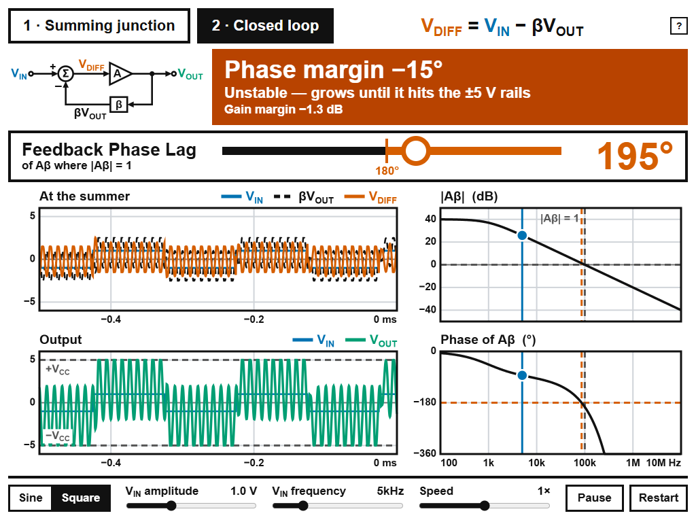
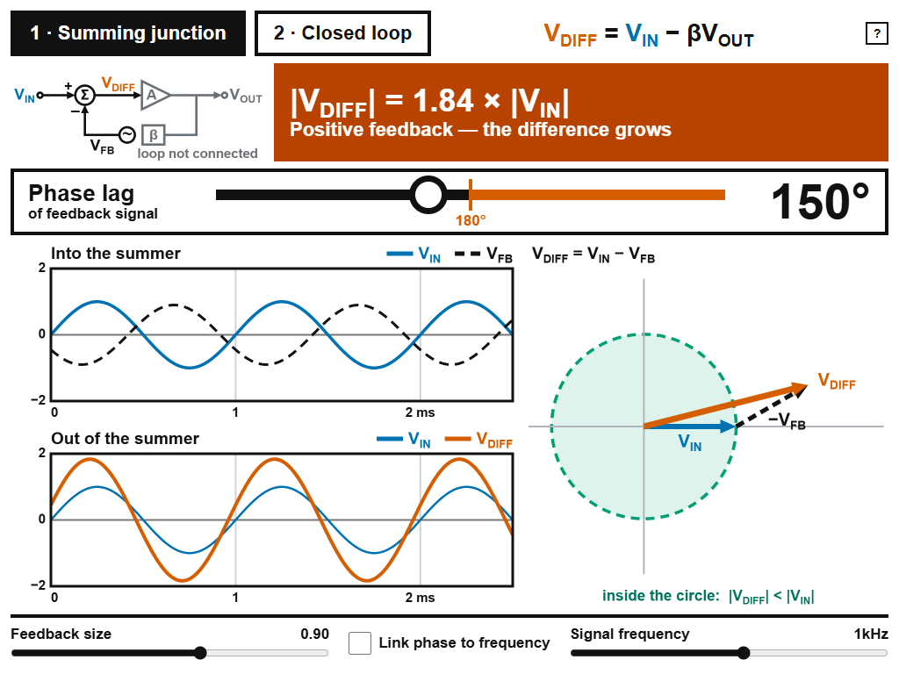
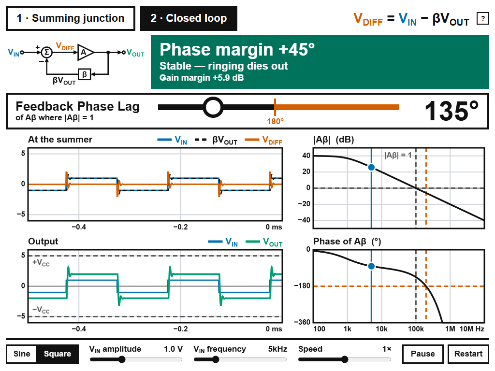
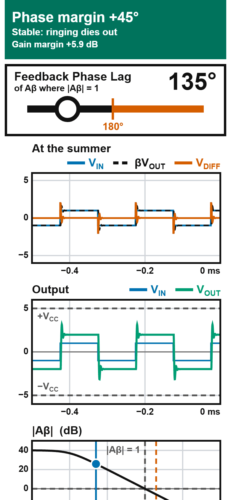

# Feedback Phase Shift Sim

Classroom demo for EE3722 Module 4.2, "The stability problem": what happens to
VDIFF = VIN − βVOUT as the fed-back signal's phase lag approaches and passes 180°.

## Quick start

**[▶ Run it in your browser](https://electricyoshi.github.io/Feedback-Phase-Shift-Sim/feedback_phase_sim.html)**
— nothing to download or install. Then drag the big **Phase lag** slider and watch the
banner change from green to orange as you pass 180°.

Works on Windows, Mac, Chromebook and Linux in a current Chrome, Edge, Firefox or
Safari, and on phones and tablets (see [Phones](#phones)).

### Offline copy

To use it without internet (it is one self-contained file):

1. **[Download the ZIP](https://github.com/electricyoshi/Feedback-Phase-Shift-Sim/archive/refs/heads/main.zip)**
   (the same thing as the green **Code** button → **Download ZIP**) and unzip it.
2. Double-click **`feedback_phase_sim.html`**. It opens in your browser.

If the offline copy doesn't work:

- **You see a page of code instead of the simulator.** You clicked the file on
  GitHub, which only shows its source. Use the **Run it in your browser** link
  above, or download it (step 1) and open the copy on your computer.
- **Double-clicking does nothing, or opens a text editor.** Right-click the file →
  **Open with** → your browser. On Windows, unzip first rather than opening the file
  from inside the ZIP.
- **A red bar appears at the top of the page.** That is an error message from the
  simulator; update your browser, and if it is still there send the text of the bar
  to your instructor.

## Things to try

**View 1 · Summing junction** — the feedback signal is just a copy of VIN; no loop yet.

- Start at 0° lag: VFB nearly cancels VIN, so VDIFF is small. That is negative
  feedback doing its job.
- Drag the phase toward 180°. Find the lag at which |VDIFF| becomes *larger* than
  |VIN| (the phasor tip leaves the green circle). The subtraction has turned into
  an addition.
- Tick **Link phase to frequency** and sweep **Signal frequency**: now the lag is the
  one the amplifier really has at that frequency, read off the Bode plot.

**View 2 · Closed loop** — the whole loop, simulated in slow motion with ±5 V rails.

- Press **Square** and step the phase up from 95° with the → key. Watch the overshoot
  and ringing grow as the phase margin shrinks.
- Go past 180° (first picture on this page): the ringing no longer dies out, it grows
  until the output hits the rails.
- Set **VIN amplitude** to 0 above 180° and press **Restart**. The loop starts
  oscillating on its own, with no input at all.

Keys: ← / → nudge the phase 1° (Shift for 10°), Space pauses. Adding `#2` to the
address opens the page straight in view 2
([direct link](https://electricyoshi.github.io/Feedback-Phase-Shift-Sim/feedback_phase_sim.html#2)).

## Run the desktop version (Python)

On Windows, double-click `Feedback Phase Sim.bat`. Or from a terminal:

    python feedback_phase_sim.py

Python 3.8+ and nothing else — it uses only the standard library (tkinter).
On Linux, tkinter may need `sudo apt install python3-tk`. It is the same simulation
and layout as the browser version (the phone layout is browser-only).

## The two views

**1 · Summing junction only.** The feedback signal is a copy of VIN with adjustable
size and phase lag; there is no loop. Shows VIN, VFB and VDIFF as waveforms and as
phasors. With "Link phase to frequency" checked, the phase follows the Bode plot at
the signal frequency (and dragging the phase moves the frequency). The signal
frequency goes down to 1 Hz, where that lag is 0°.

**2 · Full closed loop.** A time-domain simulation of the whole block diagram with
±5 V rails, running in slow motion. The phase slider sets the lag of the loop gain
Aβ at the frequency where |Aβ| = 1, i.e. 180° minus the phase margin. Below 180° a
square-wave input shows growing overshoot and ringing; above 180° the output
oscillates and grows until it clips at the rails. With VIN at 0 it starts on its own.

F11 toggles full screen (Esc leaves it; in a browser on a Mac it is Ctrl+Cmd+F).
The **?** button opens instructor notes.

## Projector layout

Built for a low-resolution 4:3 classroom projector: white background, bold type,
thick lines and a colour-blind-safe (Okabe-Ito) palette, with VFB drawn black *and*
dashed. The whole layout is designed on a 1024 × 768 stage and scales to fill the
window, so maximise it or press F11 on the projector.

## Phones

Held upright (portrait), a phone or tablet gets a single-column layout: the
controls are bigger, and you scroll down through the plots. The banner and the
phase slider stay pinned to the top of the screen, so you can drag the phase and
watch any plot respond. The other sliders are at the bottom of the page.

Turned sideways (landscape), it shows the same layout as the projector, scaled to
fit. Any browser window that is taller than it is wide gets the single-column
layout too.

 

## The model

    A(s) = 200 · e^(−sτ) / (1 + s / 2π·1 kHz),   β = 0.5

so the loop gain is 40 dB at DC and crosses 0 dB at 100 kHz. The delay τ stands in
for the excess phase of an amplifier's higher-frequency poles: it adds lag without
changing |Aβ|, which is what lets one slider move the phase curve alone. The
constants are at the top of `feedback_phase_sim.py`.

## Tests

    python -m unittest discover -s tests -v

Standard library only. `test_model.py` checks the Python model against the textbook
formulas (including the time-domain loop against A/(1+Aβ)). `test_parity.py` checks
that the browser version gives the same numbers and wording as the Python one; it
needs `node` or `deno` and is skipped without them. `test_html_portable.py` checks
the HTML is self-contained and loads from `file://` in headless Chrome/Edge (skipped
if neither is installed).

## License

MIT — see [LICENSE](LICENSE).
